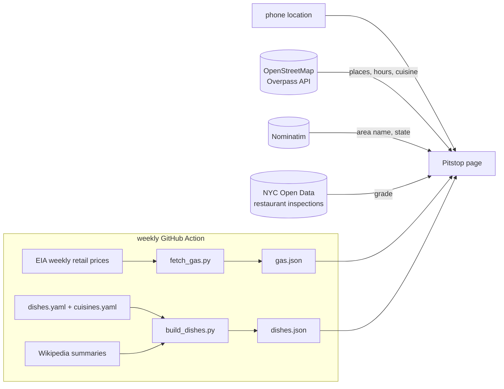

# Pitstop: gas and food near you


**Open it on your phone: [madhubuddaraju.github.io/pitstop](https://madhubuddaraju.github.io/pitstop/)**

## The problem

When you're new to a city, two everyday questions take too many steps: *where's the nearest gas station and what
should gas cost here*, and *what's still open near me right now, and what do I even order there?* Map apps answer
the first half of each, but you still have to open every listing to see closing times, and a menu full of dishes
you've never heard of doesn't help much.

## What it does

You open the page and it asks one thing: **Gas or Food?**

**Food**
- Restaurants, cafés and takeout near you, with **open now / closes at** worked out from each place's opening hours
  ("Open · closes 10:30 pm", "Closes in 25 min", "Closed · opens 7 am tomorrow").
- Filters for open now, late night (open past midnight), halal, vegetarian, and the cuisines actually around you.
- Each restaurant page has directions, call, website and menu links, the week's hours, diet and service badges,
  and in New York City its **health inspection grade** (A/B/C).
- **What to order:** the popular dishes for that cuisine, each with an **Explain** button: what's in it, how it's
  made step by step, spice level, whether it's vegetarian, a photo, and ordering tips ("Thai medium can be hot").

**Gas**
- Stations near you by distance, with hours and fuel types.
- **This week's average price for your area** (metro, state or region, whichever is most local), the change from last
  week and a 12-week trend.
- Station-level prices aren't published as open data, so you can note the price on a sign and Pitstop remembers it on
  your phone and marks the cheapest station you've seen.

Your location is used in the browser only; nothing is stored on a server.

## How it works



- **Places** come live from OpenStreetMap. The search starts within ~700 m and widens until there are enough places
  to choose from (gas starts at 3 km). Three public Overpass servers are asked at once and the first answer is used. Results are cached for 15 minutes.
- **Opening hours** are OSM `opening_hours` strings (`Mo-Th 11:00-22:00; Fr-Sa 11:00-02:00; PH off`), evaluated with
  the opening_hours.js library against your local time and public holidays. Places with missing or unparseable hours are
  shown separately as "hours not listed", not as closed.
- **Dishes** are a hand-written guide of 171 dishes across 43 cuisines (`data/`), each with ingredients, preparation
  steps, diet, spice level and tips. 160 OSM cuisine values map onto the 43 cuisines. A build step validates the files
  and adds a description and photo from Wikipedia.
- **Gas prices** come from the U.S. Energy Information Administration's weekly survey (regular and diesel, for the US,
  7 regions, 9 states and 10 metro areas). `fetch_gas.py` reads the spreadsheets by series id
  (`EMM_EPMR_PTE_Y35NY_DPG` = regular, New York City) and keeps 12 weeks. The page picks the most local series:
  metro if you're within 60 km of one, then state, then region, then the US.
- **Inspection grades** are matched from NYC Open Data by name and distance (within 120 m), using the latest graded
  inspection.

## Running it

```bash
npm install && npm test                          # app logic tests (hours, distances, cuisines, gas areas)
pip install -r requirements.txt
python -m pytest -q tests                        # data tests (EIA parsing, dish files)
python scripts/fetch_gas.py                      # refresh docs/gas.json
python scripts/build_dishes.py                   # rebuild docs/dishes.json with Wikipedia text and photos
python -m http.server -d docs 8000               # open http://localhost:8000
```

Add `?at=40.758,-73.9855&mode=food` to the URL to try any location.

## Project structure

```
docs/index.html     the app (one page, no build step)
docs/core.js        logic: distances, OSM queries, opening hours, cuisines, gas areas, inspection matching
docs/dishes.json    built dish guide
docs/gas.json       weekly prices by area
data/               dishes.yaml and cuisines.yaml, written by hand
scripts/            fetch_gas.py, build_dishes.py
tests/              Node tests for core.js, pytest for the data scripts
```

## Data and credits

Places © [OpenStreetMap](https://www.openstreetmap.org/copyright) contributors (ODbL), via the Overpass API and
Nominatim. Gas prices: [U.S. Energy Information Administration](https://www.eia.gov/petroleum/gasdiesel/).
Inspection grades: [NYC Open Data](https://data.cityofnewyork.us/Health/DOHMH-New-York-City-Restaurant-Inspection-Results/43nn-pn8j).
Dish descriptions and photos: Wikipedia (CC BY-SA). Opening hours are only as current as the map, so call ahead late
at night.

## License

MIT
