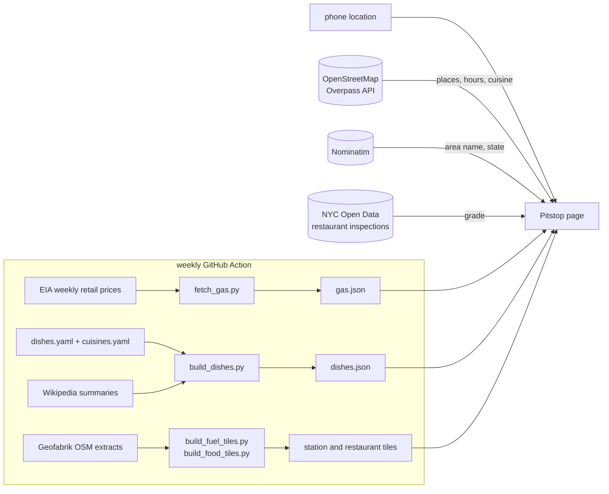

# Pitstop: gas and food near you


**Open it on your phone: [madhubuddaraju.github.io/pitstop](https://madhubuddaraju.github.io/pitstop/)**

## The problem

When you're new to a city, two everyday questions take too many steps: *where's the nearest gas station and what
should gas cost here*, and *what's still open near me right now, and what do I even order there?* Map apps answer
the first half of each, but you still have to open every listing to see closing times, and a menu full of dishes
you've never heard of doesn't help much.

## What it does

You open the page and it asks one thing: **Gas or Food?**

**Food**
- Restaurants, cafés and takeout near you, with **open now / closes at** worked out from each place's opening hours
  ("Open · closes 10:30 pm", "Closes in 25 min", "Closed · opens 7 am tomorrow").
- Filters for open now, late night (open past midnight), halal, vegetarian, and the cuisines actually around you.
- Each restaurant page has directions, call, website and menu links, the week's hours, diet and service badges,
  and in New York City its **health inspection grade** (A/B/C).
- **What to order:** the popular dishes for that cuisine, each with an **Explain** button: what's in it, how it's
  made step by step, spice level, whether it's vegetarian, a photo, and ordering tips ("Thai medium can be hot").

**Gas**
- Stations near you by distance, with hours and fuel types.
- **This week's average price for your area** (metro, state or region, whichever is most local), the change from last
  week and a 12-week trend.
- Each station's own price with a Google key (below); without one, you can note the price on a sign and Pitstop
  remembers it on your phone and marks the cheapest station you've seen.

**Optional: live prices with your own Google key.** Station-level prices aren't open data anywhere in the US, but
Google's Places API has them. Paste your own key under "Google data" on the start screen (it stays in that phone's
browser) and the gas list shows each station's regular, premium and diesel price, sorted cheapest first; restaurant
lists and pages add live Google hours, ratings and price level, and places Google knows that the map doesn't yet. For one person, the monthly free allowance covers normal use, and Pitstop never sends more than 30 Google requests a day.

**Must-try dishes from reviews** (with a Google key). On a restaurant page Pitstop reads the reviews Google shares
and lists the dishes reviewers recommend first, with a short quote: dishes from the guide that reviews name, plus items
named after phrases like "must try the…", "get the…", "recommend the…". Each has an Explain button: the dish guide
for known dishes, Wikipedia for others, or a note that it's the restaurant's own creation.

**Offers.** Restaurants don't publish promotions as open data, so each restaurant page links to its Uber Eats and
DoorDash listings, where current promotions show, and lets you save a deal you saw (kept on your phone). Happy hours
are shown where OpenStreetMap lists them.

Your location is used in the browser only; nothing is stored on a server.

## Design

The logo is the name followed by three points, red, yellow and white: the soft, medium and hard tyre compounds, and
also a signal: stop, get ready, go. The same three points run the interface. A white ring means open, yellow means
closing soon, red means closed, and while places load the points light up one by one like start lights.

The interface is dark, with a wide display face for labels and numbers and lists laid out like a timing tower (P1, P2…).
On the first visit of a session a car drives into its pit box, stops on its mark, the three lights come on and the
garage doors open onto the app (tap to skip; links that open a place or a location go straight in). Motion is short and purposeful: the logo's lights come on at launch, rows arrive in sequence, the Gas/Food switch slides,
prices count up, and detail pages rise into place. All of it is turned off for people who set "reduce motion".

## How it works



- **Places** come from prebuilt tiles where they exist (below) and otherwise live from OpenStreetMap: three public
  Overpass servers are asked at once and the first answer is used. Either way the search starts within ~700 m and
  widens until there are enough places to choose from (gas starts at 3 km).
- **Gas stations** in the US are rebuilt every week from Geofabrik's daily OpenStreetMap extracts (the six US
  regional files, cut down to fuel stations with osmium) and split into 1-degree tiles, so the page loads the one or
  two tiles around you from GitHub's CDN instead of querying a map server from every phone.
- **Restaurants** in covered metro areas (New York City and around, for now) are rebuilt nightly the same way into
  2.5 km tiles, so the food list appears in about a second. Elsewhere the page queries
  OpenStreetMap live, and the other list (gas or food) is loaded in the background while you look at the first.
- **Opening hours** are OSM `opening_hours` strings (`Mo-Th 11:00-22:00; Fr-Sa 11:00-02:00; PH off`), evaluated with
  the opening_hours.js library against your local time and public holidays. Places with missing or unparseable hours are
  shown separately as "hours not listed", not as closed.
- **Dishes** are a hand-written guide of 171 dishes across 43 cuisines (`data/`), each with ingredients, preparation
  steps, diet, spice level and tips. 160 OSM cuisine values map onto the 43 cuisines. A build step validates the files
  and adds a description and photo from Wikipedia.
- **Gas prices** come from the U.S. Energy Information Administration's weekly survey (regular and diesel, for the US,
  7 regions, 9 states and 10 metro areas). `fetch_gas.py` reads the spreadsheets by series id
  (`EMM_EPMR_PTE_Y35NY_DPG` = regular, New York City) and keeps 12 weeks. The page picks the most local series:
  metro if you're within 60 km of one, then state, then region, then the US.
- **Google data** (optional) uses Places API (New) Nearby Search for `gas_station` with `fuelOptions`, called from the
  browser with the user's key. Restaurant pages run a Text Search near the place and accept the result only if it is
  within 150 m with a matching name.
- **Inspection grades** are matched from NYC Open Data by name and distance (within 120 m), using the latest graded
  inspection.

## Running it

```bash
npm install && npm test                          # app logic tests (hours, distances, cuisines, gas areas)
pip install -r requirements.txt
python -m pytest -q tests                        # data tests (EIA parsing, dish files)
python scripts/fetch_gas.py                      # refresh docs/gas.json
python scripts/build_dishes.py                   # rebuild docs/dishes.json with Wikipedia text and photos
python scripts/build_fuel_tiles.py               # every US gas station into docs/fuel/ tiles
python scripts/build_food_tiles.py               # restaurants in covered metros into docs/food/ tiles
python -m http.server -d docs 8000               # open http://localhost:8000
```

Add `?at=40.758,-73.9855&mode=food` to the URL to try any location.

## Project structure

```
docs/index.html     the app (one page, no build step)
docs/core.js        logic: distances, OSM queries, opening hours, cuisines, gas areas, inspection matching
docs/dishes.json    built dish guide
docs/gas.json       weekly prices by area
docs/fuel/          US gas stations in 1-degree tiles
docs/food/          restaurants in covered metros in 2.5 km tiles
data/               dishes.yaml and cuisines.yaml, written by hand
scripts/            fetch_gas.py, build_dishes.py, build_fuel_tiles.py
tests/              Node tests for core.js, pytest for the data scripts
```

## Data and credits

Places © [OpenStreetMap](https://www.openstreetmap.org/copyright) contributors (ODbL), via Geofabrik extracts, the Overpass API and
Nominatim. Gas prices: [U.S. Energy Information Administration](https://www.eia.gov/petroleum/gasdiesel/).
Inspection grades: [NYC Open Data](https://data.cityofnewyork.us/Health/DOHMH-New-York-City-Restaurant-Inspection-Results/43nn-pn8j).
Dish descriptions and photos: Wikipedia (CC BY-SA). Opening hours are only as current as the map, so call ahead late
at night.

## License

MIT
